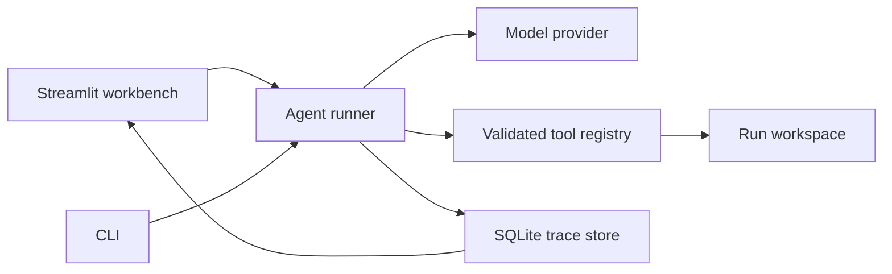

# MemoryBench

### A Benchmarking and Adaptive Memory Framework for Long-Horizon AI Agents

MemoryBench starts with a simple question: what did the agent actually do?

Version 0 gives you a tool-using Python agent, a durable execution record, and an interactive Streamlit workbench. Give it a task, inspect each tool call, and see where the time went. This is the foundation for future memory research. It does not yet implement memory retrieval, benchmarks, or evaluation scores.

## Start here

You need Python 3.11 or newer. Python 3.12 is used in the container.

```bash
git clone https://github.com/gautambalgi/Memory_Bench.git
cd Memory_Bench
python -m venv .venv
```

Activate the environment on macOS or Linux:

```bash
source .venv/bin/activate
```

On Windows PowerShell:

```powershell
.\.venv\Scripts\Activate.ps1
```

Install the app and copy the environment file:

```bash
python -m pip install -e ".[dev]"
```

```bash
# macOS or Linux
cp .env.example .env
```

```powershell
# Windows PowerShell
Copy-Item .env.example .env
```

```bash
streamlit run app.py
```

Open [localhost:8501](http://localhost:8501). Choose **Guided demo** and select **Run experiment**. The demo calculates a cost, creates a summary file, and reads it back. Its decisions are scripted, but its tools and logs are real. It needs no credentials and does not accept arbitrary tasks.

For your own tasks, put your OpenAI API key in `.env`, set `MB_PROVIDER=openai`, and choose **Live AI**. The model must support Responses API function calling. The configurable starting model is `gpt-4.1-mini`; your account must have access to it. Live requests use your API account and may incur charges. No credentials are needed for the automated tests.

```dotenv
MB_PROVIDER=openai
OPENAI_API_KEY=your-key-here
MB_MODEL=gpt-4.1-mini
```

The live adapter follows the [official function calling guide](https://developers.openai.com/api/docs/guides/function-calling), uses stateless Responses API requests with `store=False`, and carries response items forward within a single run. SDK retries are disabled so a request has a clear timeout and error record.

## What you can explore

- Watch model and tool events appear while a task runs.
- Open the result and the original task together.
- Search the event timeline and filter model, tool, or error events.
- Move the replay slider to inspect any saved event. This is an inspection view, not re-execution.
- Hover over the latency chart for individual operation timings.
- Reopen the most recent 100 runs and download a complete JSON record.
- Adjust the model step limit before starting an experiment.

The interface uses a graphite background, warm white text, mint controls, blue model timings, and amber errors. Status messages also use words, so meaning does not depend on color alone.

## Run from a terminal

The dashboard and CLI use the same execution loop:

```bash
memorybench --provider demo
memorybench --provider openai "Compare 120 * 0.035 with 80 * 0.062 using the calculator."
```

The CLI prints the full JSON run record. It exits with code 1 for an unsuccessful run and code 2 for startup or input errors.

## Project structure

```text
Memory_Bench/
  app.py                       Streamlit entry point
  src/memorybench/
    agent/
      models.py                Provider contracts
      providers.py             Live API adapter and guided demo
      runner.py                Bounded execution loop
    tools/
      builtin.py               Arithmetic, text, and workspace operations
      registry.py              Tool schemas, dispatch, and validation
    tracing/
      store.py                 SQLite runs, ordered events, and redaction
    dashboard/
      app.py                   Task entry and interactive run inspector
      style.py                 Workbench styling
    memory/__init__.py         Documented future integration boundary
    config.py                  Validated environment settings
    samples.py                 Sample tasks
    cli.py                     Headless entry point
  tests/                       Unit, integration, and dashboard tests
  .streamlit/config.toml        Theme and local server settings
  .github/workflows/ci.yml      Python checks and container smoke test
  .env.example
  pyproject.toml
  Dockerfile
  compose.yaml
```

## Architecture



The runner owns task history, step limits, deadlines, and tool execution. Providers return a small `ModelTurn` contract so model SDK details stay outside the loop. Tools advertise strict JSON schemas and validate inputs again before execution. Every run starts with fresh context.

Trace events include UTC timestamps, sequence numbers, step numbers, tool call IDs, tool inputs and results, model text, token usage when available, errors, and operation latency. The complete task and public configuration are stored with the run. Model continuation data is kept in process for the current conversation; private chain-of-thought and encrypted reasoning content are not written to the trace. This record describes observable execution, not hidden model reasoning.

Each event is committed to SQLite immediately. A crash can leave a run marked `running`, with its partial record still available. The dashboard explains this state. The final result and status are committed before the final event. An abrupt process termination can therefore leave a final status without its last event. Runs carry `schema_version=1` for future data migrations.

`completed` means the model returned a nonempty answer. It is not a correctness judgment. Tool errors can be recovered from within a run and remain visible even if the run later completes. Time or step limits produce `limited`; other unrecovered errors produce `failed`.

## Tools and boundaries

| Tool | Purpose | Boundary |
| --- | --- | --- |
| `calculate` | Arithmetic using a parsed syntax tree | No code execution; bounded expression size and numeric magnitude |
| `text_stats` | Character, word, and line counts | Up to 16,000 characters |
| `write_file` | Create a text artifact | 16,000 UTF-8 bytes; exclusive creation |
| `read_file` | Read a text artifact | 16,000 bytes; same run only |
| `list_files` | Inspect the workspace | Up to 100 filenames |

Files use simple names ending in `.txt`, `.md`, `.json`, or `.csv`. Paths, hidden files, existing symlinks, and overwrites are rejected. Workspaces are private to each run under `data/workspaces/<run-id>/`. There is no shell, arbitrary Python execution, web fetching, or access to other runs through tools.

Built-in tools run in threads and have bounded inputs. A timeout stops waiting for a thread; Python cannot forcibly cancel an in-progress filesystem operation. A timed-out write can therefore still finish. Future tools must implement their own I/O deadlines or use isolated worker processes for hard cancellation. Local workspace checks are intended for a trusted single-user host, not a security boundary against hostile local processes racing filesystem operations.

## Configuration

Settings load from the process environment and `.env` in the working directory. Environment values take priority. Restart or refresh the app after changing them.

| Variable | Default | Accepted values |
| --- | --- | --- |
| `MB_PROVIDER` | `demo` | `demo`, `openai` |
| `OPENAI_API_KEY` | empty | Required for Live AI |
| `MB_MODEL` | `gpt-4.1-mini` | Nonempty Responses API model name |
| `MB_MAX_STEPS` | `12` | 1 to 50 model turns |
| `MB_MAX_TOOL_CALLS` | `24` | 1 to 100 tool calls |
| `MB_MODEL_TIMEOUT_SECONDS` | `60` | Greater than 0, at most 300 |
| `MB_TOOL_TIMEOUT_SECONDS` | `10` | Greater than 0, at most 60 |
| `MB_RUN_TIMEOUT_SECONDS` | `180` | Greater than 0, at most 900 |
| `MB_MAX_OUTPUT_TOKENS` | `2000` | 128 to 16,000 |
| `MB_DATA_DIR` | `data` | Writable local directory |

Data files and credentials are excluded from Git and the Docker build context. The configured key, common secret fields, and recognizable `sk-` tokens are redacted from stored traces. This is best-effort redaction, not a general secret detector. Tasks, model outputs, tool results, and workspace artifacts can contain sensitive content. Use non-sensitive sample data, protect the data directory, and inspect exports before sharing them. Workspace artifacts are saved as requested and are not a redacted trace.

This release is a local research workbench. It has no authentication, shared-user isolation, retention service, or public deployment hardening. Keep it bound to localhost unless you add those controls.

## Sample tasks

1. Calculate the total cost of 18 agent runs at $0.24 each plus 7 runs at $0.61 each. Save a short summary to experiment.txt, then read it back to verify it.
2. Count the words and characters in "Good memory starts with a clear record." Save the counts to paragraph.txt and verify the file.
3. Use the calculator to compare 120 * 0.035 with 80 * 0.062. Tell me which budget is lower and by how much.

Only the first sample is supported by the scripted demo. Live AI supports all three and custom tasks that fit the available tools.

## Checks

```bash
pytest -q
ruff check .
ruff format --check .
```

Tests use temporary data directories and deterministic model responses. They cover arithmetic and filesystem boundaries, schema validation, trace persistence and redaction, agent recovery and limits, a mocked live SDK round trip, and Streamlit interactions. They do not call the live API or spend credits.

## Docker

Copy `.env.example` to `.env` before starting Compose:

```bash
docker compose up --build
```

Open [localhost:8501](http://localhost:8501). The container runs as a non-root user, binds the host port to localhost, and stores runs in the `memorybench-data` named volume. `docker compose down` preserves that volume. `docker compose down -v` deletes saved runs and artifacts.

To build and start without Compose or an environment file:

```bash
docker build -t memorybench .
docker run --rm -p 127.0.0.1:8501:8501 -v memorybench-data:/app/data memorybench
```

The image includes an HTTP health check. CI builds it and checks the running server.

## Where memory connects later

Version 0 intentionally has no vector database, embedding pipeline, memory persistence, retrieval policy, or evaluation implementation. The `memory` package documents two connection points:

1. Enrich the fresh task history before the first model request with context selected by a future retrieval policy.
2. Consume committed run events after completion to build episodic records or other memory representations.

Keep those components separate from tool execution. Future versions can add episodic, semantic, and procedural stores, adaptive retrieval, task datasets, and evaluation runners against the same headless agent and versioned trace records. Saved execution traces are observability data today; they are not silently retrieved as agent memory.
